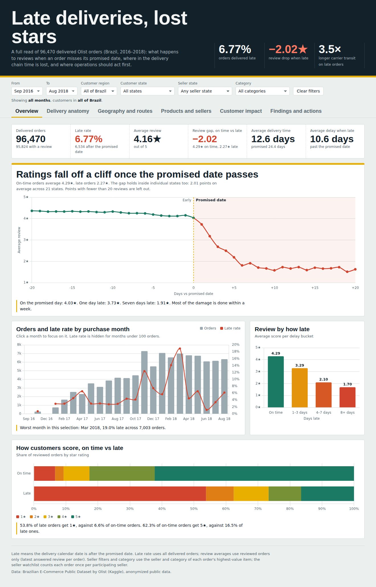
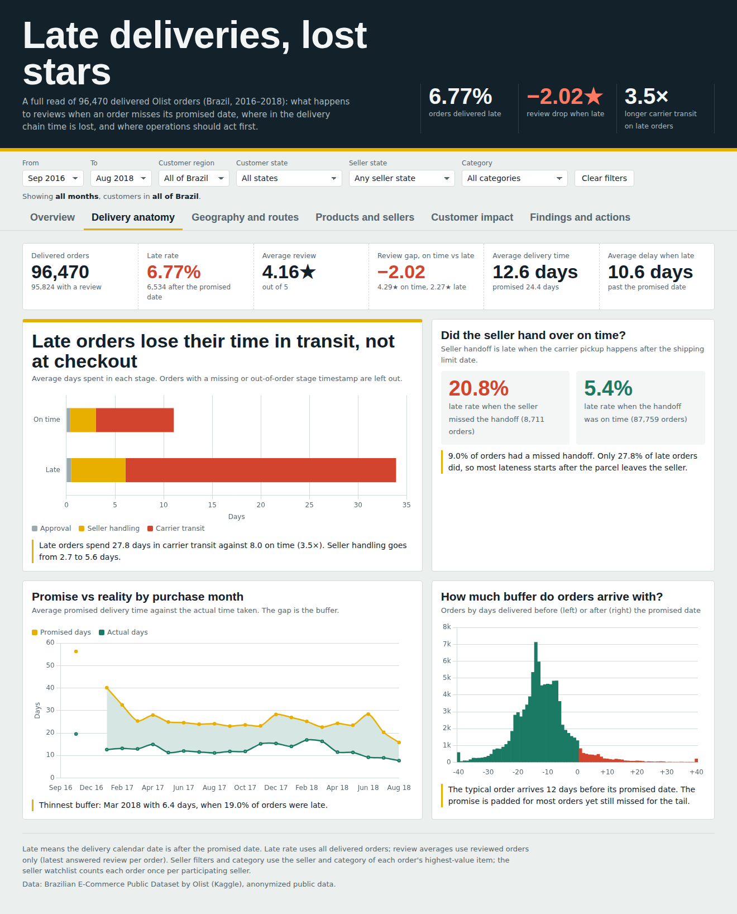
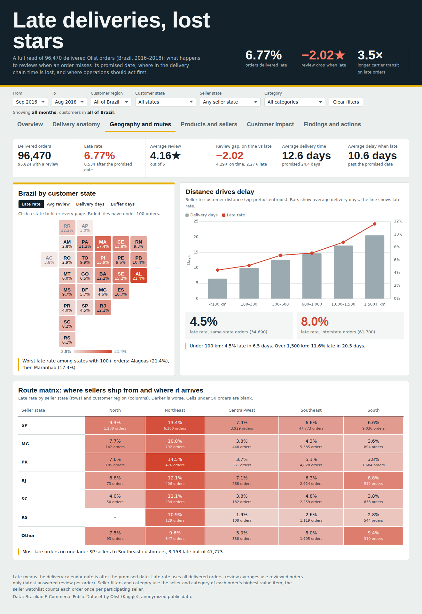
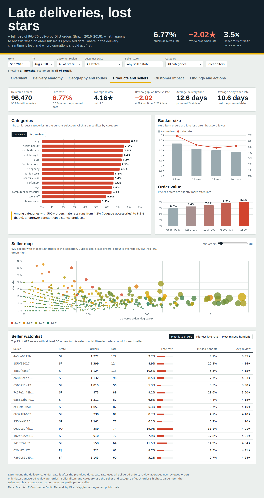
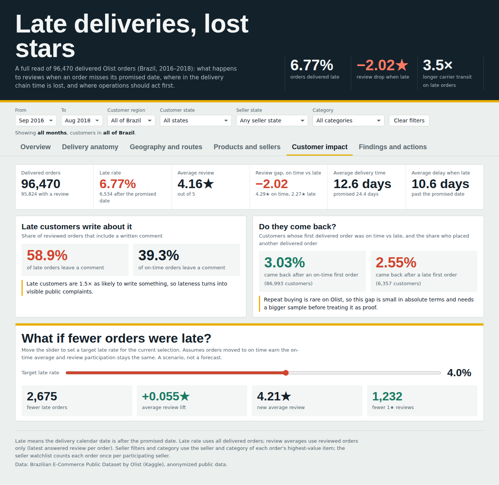

# Olist delivery reliability — pipeline and analysis

This repository contains the SQL/Python pipeline, analysis results and an interactive dashboard for **96,470 delivered Olist orders from Brazil, 2016–2018**. Raw CSVs and cleaned exports are rebuilt locally and are not committed.

The business question is: **How do customer reviews differ for late deliveries, and which states and sellers should operations investigate first?**

Late reviewed orders averaged **2.27/5**, compared with **4.29/5** for on-time reviewed orders. The delivered-order late rate was **6.77%**. These are observational associations; the analysis does not establish a causal effect.



**Live dashboard:** https://anant3623.github.io/olist-delivery-reviews/dashboard/

## Dashboard

Open [`dashboard/index.html`](dashboard/index.html) in a browser (internet needed for the chart library and fonts). Six pages: overview, delivery anatomy, geography and routes, products and sellers, customer impact, findings and actions. Filters cover purchase months, customer region and state, seller state and category; clicking a month, state tile or category bar cross-filters every page.

The dashboard adds a second analysis layer on top of the pipeline export: `dashboard/build_dashboard.py` joins `exports/fact_orders.csv` back to the raw tables for delivery stages (approval, seller handling, carrier transit), seller handoff against the shipping limit, seller-to-customer distance, category, basket size, review comments and repeat purchase. It asserts that its review selection matches the pipeline exactly. Rebuild with:

```bash
python dashboard/build_dashboard.py
```

| | |
|---|---|
|  |  |
|  |  |

### Additional findings from the dashboard layer

| Finding | Evidence |
|---|---|
| Late orders lose their time in carrier transit | 27.8 days average transit for late orders vs 8.0 on time (3.5×); approval time barely differs |
| Missed seller handoffs raise the late rate but explain a minority of late orders | 20.8% late when pickup is after the shipping limit vs 5.4% otherwise; only 27.8% of late orders had a missed handoff |
| Distance drives delay | 4.5% late under 100 km vs 11.6% beyond 1,500 km; same-state 4.5% vs interstate 8.0% |
| Late customers complain in writing | 58.9% of reviewed late orders include a comment vs 39.3% on time |

`powerbi/build_powerbi_model.py` writes an Excel star schema (fact, sellers, state and date dimensions) for rebuilding the dashboard in Power BI.

## Start here

1. Read [the findings memo](docs/memo.md) for the results, proposed actions and limitations.
2. Open the CSVs in `analysis/` for delivery status, delay buckets, purchase months, states and individual delay days.
3. Read [the data dictionary](docs/data_dictionary.md) for grain, joins, denominators and review selection.
4. Follow `python/load_raw.py` → `sql/02_staging.sql` → `sql/03_dq_checks.sql` → `sql/05_mart.sql` → `sql/04_analysis.sql` → `sql/06_robustness.sql` to study the pipeline.

The included results can be read without running PostgreSQL.

## Included files

| Folder | Contents |
|---|---|
| `data/raw/` | Input guide only; place the nine original Olist CSVs here (not committed) |
| `sql/` | Typed staging, six quality checks, order/seller marts, business analysis and within-group comparisons |
| `python/` | Raw loader, mart exporter, statistical/geographic checks, result summarizer and export validator |
| `exports/` | Rebuilt locally: cleaned `fact_orders.csv` and `seller_performance.csv` (not committed) |
| `dashboard/` | Interactive dashboard, its template and build script, screenshots |
| `powerbi/` | Script that builds the Power BI import workbook |
| `analysis/` | Result CSVs, numeric summary, data-only control aggregates, validation and statistical reports |
| `docs/` | Findings memo and data dictionary |

**Flow:** original CSVs → lossless raw text tables → typed staging views → quality checks → analysis marts → clean exports → analysis results.

## Definitions and controls

- One row in `fact_orders.csv` is one unique delivered order with usable purchase, estimated and delivery dates.
- Late means actual delivery **calendar date** is after the promised date. Same-day afternoon delivery is on time.
- Review selection uses the latest answered review, so multiple source reviews do not duplicate orders. Missing scores remain null and are excluded from rating averages.
- Seller attribution counts each order once per participating seller. Multi-seller orders can belong to more than one seller.
- Delay outliers are retained as outcomes rather than automatically deleted. Historical and small cohorts need cautious interpretation.

| Control | Expected value |
|---|---:|
| Delivered orders | 96,470 |
| Late orders | 6,534 |
| Reviewed orders | 95,824 |
| Sum of review scores | 398,233 |
| Sum of positive late delay days | 69,392 |
| Average review | 4.155879529 / 5 |
| Average delay among late orders | 10.620140802 days |
| Customer states | 27 |
| Sellers with at least 30 delivered orders | 627 |

The within-state and within-seller descriptive gaps are **2.005** and **1.971** points respectively. The memo explains eligibility and weighting. Neither comparison controls for every possible confounder.

## Reproduce the analysis

Requirements: Python 3.10+, a running PostgreSQL server, `psql` and `createdb` on your command path, and the dependency in `requirements.txt`. All nine raw input CSVs are included.

From this package directory:

```bash
python3 -m venv .venv
source .venv/bin/activate
pip install -r requirements.txt
createdb olist_delivery_analysis
export PGDATABASE=olist_delivery_analysis
make all
```

Use `PGHOST`, `PGPORT` and `PGUSER` if your PostgreSQL installation needs them. On a Mac with the PostgreSQL 18 installer, you can set `PSQL=/Library/PostgreSQL/18/bin/psql` when calling `make`; `createdb` also needs to be available. Rebuilding reloads the raw tables and replaces marts inside the named analysis database.

To verify the included data without rebuilding a database:

```bash
python3 python/validate_outputs.py
python3 python/summarize_analysis.py
python3 python/stats_test.py
```

`python/geographic_check.py` additionally needs SciPy and the included raw geolocation CSV. The validator checks every fact row, seller attribution and within-group summaries against the control snapshot. That snapshot records the verified full source dataset; changed input data require a new baseline and findings review.

## Source

Data: [Brazilian E-Commerce Public Dataset by Olist](https://www.kaggle.com/datasets/olistbr/brazilian-ecommerce). The source dataset is anonymized, historical public data. Preserve its source attribution and dataset terms when reusing or distributing it.


## Data and licence

Source: [Brazilian E-Commerce Public Dataset by Olist](https://www.kaggle.com/datasets/olistbr/brazilian-ecommerce) on Kaggle, licensed CC BY-NC-SA 4.0. Raw files are not redistributed here. The dashboard embeds a compact, derived order-level dataset (no customer or order identifiers); it is shared under the same CC BY-NC-SA 4.0 terms, with attribution to Olist, for non-commercial portfolio use.
